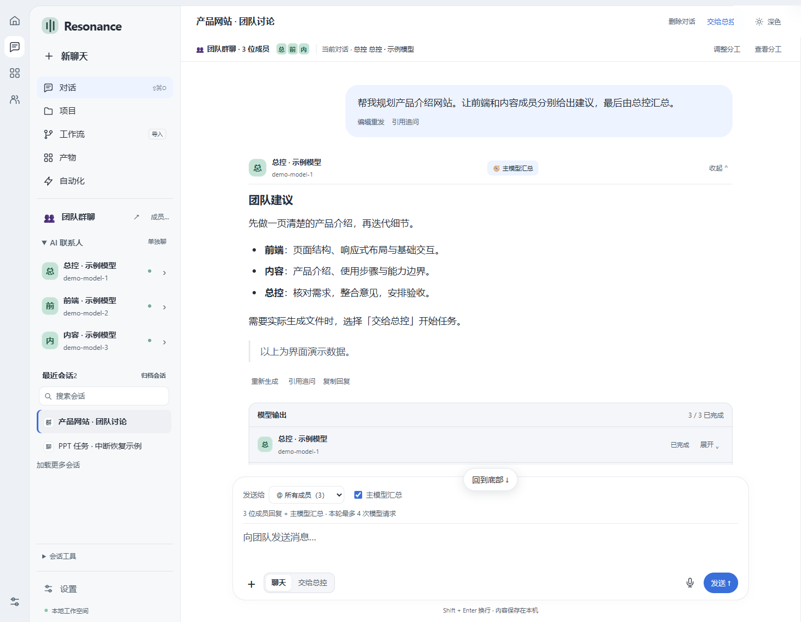

# Resonance

**一个对话窗口，多位 AI 协作，一处审阅成果。**

Resonance 是本地运行的多 AI 工作台。连接不同厂商和本地模型，让总控分析需求、安排角色，在同一处查看讨论、修改、测试和交付物。适用于代码项目、网站、PPT、文档与项目计划。

当前为 **v1.1.3 Windows 预览版**。原名称为“共鸣”，数据目录与文件格式保持兼容。界面保留中文。项目与模型厂商没有官方关联。许可证：[Unlicense](LICENSE)。



截图为本地模拟数据，不代表真实模型生成结果或已开通账号。

本次安全加固与边界见 [安全加固说明](docs/SECURITY-HARDENING.md)。

## v1.1.2 常用技能与演示改进

- 预置 8 个常用技能：PPT、网站、报告、项目计划、需求验收、代码审阅、测试排错与日常整理。按任务和角色选择，支持停用、自定义和 SKILL.md 导入。
- 每次最多使用 2 个相关内置技能和 2 个自定义技能，总正文最多 8,500 字符；任务可查看实际使用记录。
- PPT 增加分项、对照、流程和重点版式，以及浅色、深色和绿色配色。预览与可编辑 PPTX 共用布局，编辑时可调整版式。
- [技能使用说明](docs/SKILLS.md) 与 [八页产品介绍示例](docs/examples/resonance-presentation.json)。示例由人工整理，不冒充真实模型任务记录。

## v1.1.1 运行修复

- DeepSeek 官方 deepseek-flash / v4-pro 默认快速回复，明确关闭官方默认的高强度推理；在高级连接设置可选择深度思考。
- SSE 协议流量与最终正文分别限额，避免短答案被推理流和事件开销触发 3 MB 限制。
- “为什么没调用 Kimi”等普通问题即使在任务模式发送，也转为对话；启动任务后输入框回到聊天。
- 内容初稿与模型验收结果分开。结构有效的 PPT 可预览、修改和导出；验收缺项保留，不冒充验收通过，也不沉淀成成功技能。代码工作流仍必须通过严格测试与验收。
- 已生成的旧 PPT 继续时不重复制作；验收报告保留为人工核对清单。

## 之前更新

- **及时收到回复**：后端 SSE 推送，变化的消息局部更新；历史消息不会每秒重绘，图片不随完整对话重复传输。
- **完整保留讨论过程**：引用追问、编辑分支、重新生成、多个回复版本、归档、会话导入和导出。切换较早版本会建立分支，原来的后续对话保留。
- **清楚的导航**：对话、项目、工作流、产物、自动化；模型、助理与技能、MCP 等配置集中在设置。自动化页面如实说明尚未提供定时执行。
- **可分享的工作流**：内置网站、PPT、文档、项目计划、代码流程；支持本地 JSON 导入、导出、自建与钉住，运行前查看并确认配置。
- **开发可分步进行**：Agent 可以在隔离工作树中列文件、检索、分块读取和分批写入；保存已接受步骤的检查点，避免恢复时重新生成相同输出。
- **更轻的本地存储**：聊天图片按内容摘要独立保存；连续回复的快照不反复写入 base64 图片。审计历史可分页读取。
- **有证据的网站检查**：Windows 桌面版在无网络、无本机工具权限的隔离浏览器检查宽度、基本可访问性与指定交互。结构检查与真实执行结果分开记录。
- **本地代码高亮和图片处理**：代码块安全高亮、任务清单、上传图片缩放压缩、回到底部与新回复提示。

已完成与尚待完成的项目见 [优化状态](docs/OPTIMIZATION-STATUS.md)，验证方法见 [TESTING.md](TESTING.md)。

## 三步开始

1. 解压 Windows 软件包，双击 **Resonance.exe**，保留完整文件夹。也可以运行包内安装脚本，安装到当前用户目录并建立桌面快捷方式。
2. 打开「设置 → 模型连接」，选择服务商，填写 API Key 并选择可用版本；Ollama / LM Studio 支持检测本地服务。同一密钥可添加多个模型版本。连接测试可能产生服务商费用。
3. 新建对话，选择单个 AI 或团队。需要制作文件时选择「交给总控」或进入「工作流」，查看过程、处理审批，再审阅与导出。

> 做一份 8 页的读书会活动策划 PPT，面向大学生，包含时间表、预算和报名方式。没有提供的数据请标注待确认。

> 为现有项目增加登录页面。前端模型负责页面，后端模型负责接口，先列方案和验收标准，再实现。

日常文档、PPT 和网站会自动创建任务工作区。修改已有代码时选择有初始提交的 Git 仓库；未提交修改不会自动带入任务工作树。操作说明见 [使用指南](docs/USAGE.md) 和 [工作流导入](docs/WORKFLOW-IMPORT.md)。

## 从源码运行

需要 Node.js 22+。本地 HTTP 服务没有 npm 运行依赖：

```sh
npm start -- --port 4173
```

源码用户在 Windows 双击唯一入口 `启动Resonance.cmd`，或运行 `npm start`，然后打开终端打印的完整访问链接（含 `#session=`）。不要同时启动两份服务；重启后使用新链接。桌面版直接打开 `Resonance.exe`，无需再运行脚本，鉴权会自动完成。桌面开发及打包：

```sh
npm install
node node_modules/electron/install.js
npm run desktop
npm run check
npm test
npm run desktop:package
npm run source:package
```

Electron 固定为 44.7.0。Git 用于隔离工作树与版本操作；Docker 用于代码任务的受限容器测试。完整构建说明见 [DESKTOP.md](DESKTOP.md)。

## 模型与协作

支持 OpenAI 兼容 API、Anthropic 原生 API、Ollama 与 LM Studio。预设覆盖 DeepSeek、Kimi、Gemini、通义千问等，实际可选型号来自账号列表或用户手填；预设不意味着获得服务权限。

团队群聊可邀请多位模型，默认集中看主模型汇总，按需展开每位成员的流式回复。成功回复保留，重试只补未完成部分。主模型汇总会额外调用一次；不同服务商分别计费，不共享提示词缓存。

聊天用于讨论；实际修改文件由明确提交的任务执行。总控、角色与已连接模型直接显示在会话中。开发角色有受限工具循环，整体任务仍基于有界阶段依赖，并非任意自主 Agent 图。

API / 本地与订阅 / 编码工具分组显示。ChatGPT 官方授权代码已实现但真实账号端到端验证尚未完成；Claude、Cursor 订阅执行适配器仍待接入，不能把订阅当成 API Key。

## 数据与审批

桌面数据保留在 `%APPDATA%\\Gongming\\workspace`；旧名称用于兼容，不影响 Resonance 的界面名称。源码模式默认使用 `.runtime/`。升级前退出程序并备份完整工作区，图片存储目录也需要一并备份。

系统加密可用时保存 API Key，命令行模式或加密不可用时仅保存在内存。跨电脑迁移可能需要重新填写密钥。使用云模型时，选中的上下文会发送给相应厂商。

文件改动保留在独立 Git 工作树。命令、提交、合并和回滚通过具体审批处理。自动批准选项仅适用于用户选择的无网络、只读、资源受限容器测试，不包括 Git 或 MCP 操作。

源码打包只收录白名单文件，不包含工作区、凭据和聊天。请上传生成的源码包内容；Windows 程序 ZIP 放 GitHub Releases。见 [GitHub 上传说明](GITHUB-PUBLISH.md)。

## 当前边界

| 项目 | 当前范围 |
| --- | --- |
| 流程 | 开发最多 24 轮受限工具步骤；未知结果的模型请求不自动重发，重启不能恢复原服务商生成连接 |
| 代码规模 | 按需检索最多 20,000 个源码路径；分块读取，单轮写入仍有限制；工作流校验最多 512 文件 / 8 MB |
| 图片与会话 | 每轮 4 张 / 5 MB，每会话 20 MB 图片；最近会话 30 个，可归档；长对话可分支续聊 |
| 网站 | 支持项目内相对 JS / CSS 合并预览；不支持任意构建工具、模块导入或联网业务自动验收 |
| PPT | 4–20 页结构化内容与可编辑 PPTX；复杂图片、图表、母版和 PowerPoint 视觉验收仍待完善 |
| MCP | Streamable HTTP；不支持 stdio、旧 SSE endpoint、OAuth 或自主循环调用 |
| 工作流导入 | 本地 JSON 与从对话保存；不支持 URL 抓取、任意阶段、模型权限覆盖或脚本执行 |
| 自动化 | 尚未提供定时或事件触发运行；不会伪造自动化已执行 |
| 桌面分发 | Windows 文件夹包及当前用户安装脚本；无代码签名、自动更新及已验证的 macOS / Linux 发行版 |
| 测试范围 | 自动测试使用本地模拟模型与临时 Git；真实云推理、订阅、麦克风和 Docker 仍需对应环境验证 |

链接附件目前作为参考地址发送，不自动抓取网页。语音使用可用的浏览器识别或 Windows 系统听写，发送前由用户检查。仅打开 HTML 不会自动产生真实模型任务。
